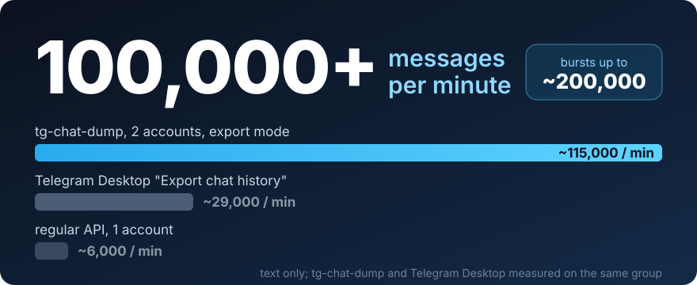
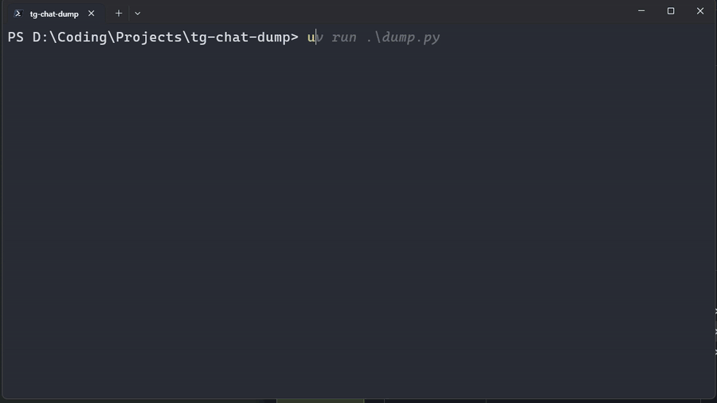

# tg-chat-dump

[](https://pypi.org/project/tg-chat-dump/)
[](pyproject.toml)
[](https://github.com/LonamiWebs/Telethon)
[](LICENSE)
[](https://github.com/renkagod/.github/blob/main/DONATE.md)

<p align="center"></p>

<p align="center"><br><sub>A 421,393-message group dumped in 3m 47s with two accounts (the download part is sped up 12×; account names are blurred).</sub></p>

Dump an entire Telegram chat into SQLite and a folder per forum topic at **over 100,000 messages a minute**. It runs Telegram's own data-export mode with parallel workers on several accounts, so a chat of several hundred thousand messages is done in minutes: about 4× faster than Telegram Desktop's own export, and a whole forum in one pass instead of topic by topic.

```
out/1234567890_My_Chat/
├── index.html          the offline reader (html extra)
├── 1_General/
│   ├── messages.jsonl
│   └── messages.txt
├── 12_Off-topic/
│   ├── messages.jsonl
│   └── messages.txt
└── 37_Announcements/
    ├── messages.jsonl
    └── messages.txt
```

## Features

- Over 100,000 messages a minute with Telegram's export mode and two accounts: about 4× Telegram Desktop's export and 10× the regular API (see [Performance](#performance)).
- Run it without arguments for the interactive mode: log in with a QR code, find a chat as you type or paste its link, update everything you dumped before in one go, watch a progress bar with ETA.
- A whole forum in one pass. Messages are sorted into topics as they arrive. Or single topics, General included, with the same filters as a whole chat.
- The chat is split into message-id ranges that several workers download at once. Telegram limits each account separately, so every extra account adds about as much speed as the first.
- Progress is committed to SQLite every 100 messages. An interrupted run resumes where it stopped, and later runs fetch only new messages and append them to the files, so a repeat run of a large chat takes seconds. When a forum topic is renamed, its folder is renamed too.
- A repeat run also finds the messages edited or deleted since the last one. An edited message keeps its earlier text next to the new one, a deleted message stays in the dump and is marked as deleted (see [Edits and deletions](#edits-and-deletions)).
- Everything the Telegram app shows with a message, not only its text: rich messages laid out in blocks, file names and sizes, link previews, polls and checklists, places and contacts, buttons with their links, quotes in replies, replies to other chats, forward sources, author signatures and admin titles, fact checks, service actions with their details.
- The chat around the messages too: its description, picture, member count and settings, the icons and states of forum topics, pinned messages, and everyone who wrote, under their current name and username (see [The chat and its people](#the-chat-and-its-people)).
- The files too, when asked: photos, videos, voice messages and documents, within limits on size and type, and shown in place by the reader (see [Files](#files)).
- Optional extras, each a toggle: reactions and views, formatting with hidden links, comments under channel posts, people's bios, who reacted and who voted, files, and Telegram's export mode (see [Extras](#extras)).
- Other formats in and out: a CSV for spreadsheets, the JSON of Telegram Desktop's own export for the programs that read it, and an export made by Telegram Desktop read into a dump, which brings back messages deleted since (see [Other formats](#other-formats)).
- Filters by date range, author or message type, such as links or documents.
- Search across all your dumps at once, offline (see [Search](#search)).
- A schedule kept by the system itself: `--schedule 04:30`, and every chat you dumped is brought up to date daily (see [On a schedule](#on-a-schedule)).
- On `FLOOD_WAIT` the run sleeps and then continues on its own.
- SOCKS5 and HTTP proxies, for networks where Telegram is blocked.
- `index.html` to read the dump in a browser, offline; `messages.txt` for reading in an editor, `messages.jsonl` for scripts, and the SQLite database for queries.

## Quick start

1. Create an app at [my.telegram.org](https://my.telegram.org) → *API development tools* and note its `api_id` and `api_hash`.
2. Install and run:

   ```sh
   pipx install tg-chat-dump
   tg-chat-dump
   ```

   `uv tool install tg-chat-dump` or `pip install tg-chat-dump` work too. Installed this way, settings and sessions are kept in `~/.tg-chat-dump` and dumps go to `~/tg-chat-dump`.

   From source, with [uv](https://docs.astral.sh/uv/), everything stays inside the checkout (`.env`, `data/`, `out/`):

   ```sh
   git clone https://github.com/renkagod/tg-chat-dump.git
   cd tg-chat-dump
   uv run dump.py
   ```

The first start asks for `api_id` and `api_hash`, saves them to `.env` and logs you in: scan a QR code in Telegram on your phone (*Settings → Devices → Link Desktop Device*), or type `p` to log in with the phone number. On the first dump Telegram asks to allow the fast export mode: the "Telegram" chat gets a data export request, tap Allow there and press Enter (see [Extras](#extras)). After that it works like this:

```
Accounts: Alice @alice, Bob
Extras: takeout, html   Output: D:\Telegram dumps
Loading your chats… 312 found.

Search chat (name, @username, id or t.me link; Enter: your dumps, /: settings): forum
   1) Forum Club  @forumclub  [forum]  2/2 accounts
   2) Forum News  @forumnews  [channel]  1/2 accounts
Number, [p] search public chats, or type to search again > 1

Forum Club  [forum]  id -1001234567890
~152,310 messages
Dump it with 2 accounts, extras: takeout, html? [Y/n, f = filters]
[████████░░░░░░░░░░░░]  41%  62,104 saved  112,400/min  ETA 48s
```

- Matching chats pop up under the cursor as you type; Tab fills in the highlighted one and Enter picks it. A pasted `t.me` link or an exact `@username` works too.
- `?` and some words search the messages of the chats you dumped before (see [Search](#search)).
- Enter on an empty search lists the chats you dumped before, the latest first, with how many messages are saved. Pick one to fetch its new messages, several to update them in a row (`2 5 7` or `4-6`), or `u` for all of them.
- In the list a search gives, a number picks a chat; several (`1 3` or `2-4`) are dumped one after another with the saved extras.
- If nothing in your chats matches the search, public groups and channels are searched too. Public chats can be dumped without joining.
- Every account that can see the chat is used. A private chat or a small (non-super) group is the exception: each account has its own copy of it, so you see how many messages each one has and pick one. Enter takes the account that saved the chat before, or the biggest copy.
- `/` opens the settings: add (`a`) or remove (`d N`) accounts, toggle the extras (`x`), set the output folder (`f`), have the dumps updated on a schedule (`s`). They are saved. By default the output goes to `~/tg-chat-dump`, or `out/` in a source checkout.
- Answering `f` instead of `Y` asks for filters for this one dump.
- When a dump is done, `o` opens it in the browser (with the `html` extra) and `f` opens the folder.
- **Ctrl+C** stops the dump; the next run resumes it.
- If Telegram is blocked in your network, set `TG_PROXY` in `.env`, for example `TG_PROXY=socks5://127.0.0.1:1080`.
- The interactive mode is colored in a terminal; set `NO_COLOR=1` to turn colors off.

## Extras

`takeout` and `html` are on by default, the others are off. Switch them with `x` in the interactive mode, `--with` on the command line (it replaces the saved list), or `TG_OPTIONS` in `.env`; `TG_OPTIONS=none` turns all of them off.

| Extra | Adds | Cost |
|---|---|---|
| `meta` | `reactions` (`{"👍": 12}`), `views`, `forwards`, `replies` | none, it is already in every message |
| `markdown` | `text_md`: the text as Markdown, with bold, links behind words, mentions | none |
| `comments` | for a channel: the comments under its posts, from the linked discussion group, in `comments/`, grouped by post | a second dump of the discussion group |
| `bio` | the bio of everyone who wrote in the chat, in `users.jsonl` and the `users` table | one request per person, and Telegram lets through about 50 a minute per account: 5,000 authors take an hour and a half with one account, under an hour with two. It runs after the messages are saved and exported, each person is asked about once, and a stopped run goes on with the rest next time |
| `who` | who reacted to each message and who voted in each poll: `reacted` and `voted` in `messages.jsonl`, the names under the message in `messages.txt` and in the reader | one request per message with reactions, about 10 a second per account: 40,000 such messages take about half an hour with two accounts. It runs after the messages are saved and exported, a message is asked about again only when its counts change, and a stopped run goes on with the rest next time |
| `files` | the photos, videos, voice messages, music and documents attached to the messages, in `files/` inside each topic folder, with the path in `extra.file.path` (see [Files](#files)) | the download itself: it takes what your connection needs for the files within the limits, and their size on disk |
| `takeout` | runs the dump in Telegram's data-export mode, the one Telegram Desktop uses; it skips the usual rate limits, about 10× faster (see [Performance](#performance)) | the first time, Telegram asks you to allow the export in the app (the interactive mode waits for it), otherwise it opens after 24 hours; until then the dump runs at normal speed |
| `html` | `index.html` in the chat folder: read the dump in a browser, offline, with topics, search, replies and jumps to a date | a few seconds on the first run for a chat of several hundred thousand messages, then a fraction of a second |
| `csv` | `messages.csv` in every topic folder, a row per message, for a spreadsheet (see [Other formats](#other-formats)) | none |
| `tdesktop` | `result.json` in the chat folder: the whole chat in the format of Telegram Desktop's own export, for the programs that read it (see [Other formats](#other-formats)) | the file is written whole on every run that found something new: about 3 seconds per hundred thousand messages |

`bio`, `who` and `files` run at the same time: each asks Telegram for a thing of its own, which it limits apart, so together they take about as long as the slowest of them. How much time each extra adds to a dump is in [What the extras add](#what-the-extras-add).

Turning an extra on later does not touch messages that are already saved. A new run adds it to new messages only; `--refetch` adds it to the saved ones too, and asks for the bios again. `files` and `who` are the exceptions: they cover the saved messages from the start (`who` those whose reaction counts are saved). Polls and checklists are always saved now; the old `polls` extra is still accepted and does nothing.

## Filters

```sh
uv run dump.py @somegroup --since 2026-01-01 --until 2026-03-31   # a date range, inclusive
uv run dump.py @somegroup --since 2026-03 --until 2026-03         # all of March
uv run dump.py @somegroup --since 7d                              # the last 7 days (also 2w, 3m)
uv run dump.py @somegroup --from @alice                           # one author
uv run dump.py @somegroup --type links                            # links, docs, photos, videos, voice, pinned, ...
```

A filtered dump gets its own database and folder, for example `out/1234567890_My_Chat_since-2026-01-01_links/`, so it never mixes with the full dump. Filters can be combined.

`--topics 12,37` takes single topics of a forum instead of the whole chat; `1` is General. On its own it is a part of the chat's dump: the topics are saved to the chat's database and written to their folders in the chat's folder, and a repeat run fetches what is new in them. Together with filters, the topics are brought up to date first and the filtered messages go to a folder of their own, such as `out/1234567890_My_Chat_topics-12-37_since-2026-01-01/`:

```sh
uv run dump.py @someforum --topics 1                       # General alone
uv run dump.py @someforum --topics 12,37 --since 30d       # the last 30 days of two topics
uv run dump.py @someforum --topics 12 --type photos --with files   # the photos of one topic, downloaded
```

When the whole chat is already dumped, the filters are applied to the saved copy: the whole chat is brought up to date first, then the filtered folder is written from it without downloading the messages again. That goes for `--type` too. The saved messages tell their media, files and pins apart, and links are found the way the app shows them: addresses, bare domain names, links under words, link previews. On a large chat that finds 98% of what Telegram's own search for links returns, and about 5% on top, mostly addresses inside code blocks. Only a dump that still has messages saved before 1.3.0 asks Telegram for `--type`, until `--refetch`.

## Edits and deletions

A repeat run does more than fetch the new messages: it brings the saved ones in line with Telegram. An edited message gets its new text and the earlier one is kept. A deleted message is not dropped from the dump, it is marked as deleted.

- A channel or supergroup has a log of changes on Telegram's side, and the run reads it from where the last run stopped. The log lists every edit and deletion in the chat, however old the message, and reading it takes a few requests: a day of a busy group, with thousands of new messages, is read in about ten seconds. It works for a public channel you have not joined too.
- The log is not endless: it holds about the last 100,000 changes, new messages included. That is years of a quiet channel and several days of a group with thousands of messages a day. A private chat or a small group has none. In these cases the messages written from two days before the last run on are downloaded again and compared with the saved ones; two days is how long Telegram lets a member edit a message. `--recheck 7` goes a week back instead, `--recheck 0` turns the whole check off.
- `--refetch` compares the whole chat.

Only what a run saw can be kept: a text replaced before the first dump, or written and replaced between two runs, is not known. The date of a deletion is the day the run found the message missing. A filtered dump is not checked on its own; one made from the saved whole chat gets the edits and deletions with it.

## The chat and its people

Every run also saves what the app shows around the messages, and brings it up to date.

- **The chat itself**: description, picture, member count, username and invite link, the linked channel or discussion group, slow mode, auto-delete, and what members are not allowed to do. It is written to `chat.json`, and the reader shows it when you click the chat's name.
- **Forum topics**: when and by whom a topic was created, its icon and colour, whether it is closed or pinned. The reader shows the icons, lists pinned topics first and marks closed ones. A topic deleted in Telegram keeps what was saved of it.
- **Pinned messages**: the marks follow the chat's own list, so a message unpinned a year after it was saved loses its mark. The reader lists a topic's pinned messages behind the pin button. Telegram lists pins only as far back as the account sees the chat; marks on older messages stay as they were.
- **People**: everyone who wrote, with name, username, and whether it is a bot or a deleted account, in `users.jsonl` and the `users` table. A message keeps the name it was sent under; the table has the current one. People who wrote since the last run are updated as their messages arrive. The others are asked about again, those not asked about for the longest first, as many as Telegram answers without a wait: about 400 per account in one run, so a chat with thousands of authors goes round in several runs. The `bio` [extra](#extras) adds their bios.
- **Who reacted and who voted**, with the `who` [extra](#extras): for every message with reactions, who put which one and when; for a poll, who chose which answer. These people are added to `users.jsonl` too. Telegram tells this only in groups: a channel does not say who reacted to its posts, and neither does a post that came to a group from its channel. The voters of a poll are shown when the poll is not anonymous, and only to an account that has voted in it itself; the dump never votes. Reactions are asked about for the messages whose counts are saved, which the `meta` extra and `who` itself do; for messages saved without them, run `--refetch` once. With a filter or `--topics`, only the messages of that dump are asked about.

## Files

With the `files` extra a run also downloads what is attached to the messages: photos, videos, GIFs, voice and round video messages, music and documents. A file lands in the `files` folder inside the folder of its topic (inside the chat folder when the chat has no topics), named by the message id and the file's own name: `1045_notes.pdf`, `1043.jpg`. The message says where its file is in `extra.file.path`, and the reader shows it in place: photos, videos and GIFs in the message, voice messages and music with a player, any other file as a link.

Two settings say what is downloaded:

- `--file-size 50`, or `TG_FILE_SIZE` in `.env`: the largest file, in megabytes. The default is 20, and `0` takes files of any size.
- `--file-types photos,voice,docs`, or `TG_FILE_TYPES`: any of `photos`, `videos`, `gifs`, `voice`, `round`, `music`, `docs`, `stickers`, or `all`. The default is everything but stickers, which are the same few files sent over and over.

In the interactive mode both are under `x`, then `f`.

Files come after the messages are saved and exported, the newest first, and each one is noted as it lands. A run stopped halfway loses nothing, and the next one goes on with what is missing. A file is downloaded once; delete it from the folder and the next run brings it back, raise a limit and the next run downloads what it now allows. The extra looks at every saved message, not only the new ones, so it can be turned on for a chat dumped long ago. Only a message that is still in Telegram has a file to download.

Filters narrow it down: `--type photos --with files` downloads the photos of a chat into the filtered folder and nothing else, and `--topics 12 --with files` the files of one topic. With several accounts each takes its share. Unlike messages, files take as long as your connection needs: a chat with tens of thousands of photos is several gigabytes.

Files are decrypted by [cryptg](https://pypi.org/project/cryptg/), which is installed with tg-chat-dump on Windows, Linux on x86-64 and ARM, and Macs with Apple silicon. Elsewhere, such as an Intel Mac, it is left out, and files come at about 0.5 MB/s instead of several MB/s; `pip install cryptg` there (it needs Rust) brings the speed back.

A web page sent to the chat (`.html`, `.svg`) is saved like any other file, but the reader does not link to it: opened from the folder of the dump, a page could read the dump.

## Search

`--search` looks for words in everything you have dumped, all chats at once, without the network:

```sh
uv run dump.py --search "pizza cutter"                    # messages that have both words, in any case
uv run dump.py --search '"pizza cutter"'                  # the phrase as it is
uv run dump.py --search pizza @somegroup --from @alice    # in one chat, from one author
uv run dump.py --search invoice --since 2026-01 --type docs --limit 100
```

```
Forum Club: 2 messages  file:///D:/Telegram%20dumps/1234567890_Forum_Club/index.html
  2026-03-14 09:02  Plans · Bob: pizza is fine, but who brings the pizza cutter?  #topic/12/msg/1043
  2026-03-14 09:01  Alice: no pizza for me  #topic/1/msg/1042
```

Every chat with matches is listed with the address of its reader and its newest matches, 20 unless `--limit` says otherwise. The end of a line is the message's place in the reader: `index.html#topic/12/msg/1043` opens it. The chat is named by id, `@username`, link or a part of its title, and `--from` takes an id, an `@username` or a part of a name: the search knows what is saved and asks Telegram nothing. Deleted messages are found too, and marked. Two million messages in nine chats are searched in about five seconds.

In the interactive mode, type the words after a question mark at the chat prompt: `?pizza cutter`.

## Other formats

Two extras write the dump in formats other programs read, next to the usual files.

- **`csv`**: a `messages.csv` in every topic folder, a row per message, with the columns `id`, `date`, `edit_date`, `topic_id`, `sender_id`, `sender`, `text`, `reply_to`, `fwd_from`, `media`, `file`, `action`, `views`, `forwards`, `replies`, `reactions`, `deleted_at`. It opens in Excel, LibreOffice or Google Sheets as it is, Cyrillic and emoji included. Like the other files it grows by the new messages on a repeat run. Turned on for a chat dumped before, it is written for all the saved messages at once.
- **`tdesktop`**: a `result.json` in the chat folder, the whole chat the way Telegram Desktop's own "Export chat history" writes it in JSON: the same field names, service messages, media and reactions, and the text with its formatting when the `markdown` extra saved it. Programs made for Telegram's exports, such as chat statistics, read it as they would read the real one. With the `files` extra the messages point at the downloaded files. It is written whole whenever something in the chat changed.

It works the other way too. An export made by Telegram Desktop (*⋮ → Export chat history*, format JSON) is read into a dump, and no account is needed for that:

```sh
uv run dump.py --import "D:\Downloads\ChatExport_2024-05-01"   # the folder, or its result.json
uv run dump.py --import result.json --with html,csv            # with the extras that write files
```

The chat gets its database and its folder like any other, with the reader, and the photos and files the export came with are copied into it. An export of the whole account (*Settings → Advanced → Export Telegram data*) is read chat by chat.

- If the chat is dumped already, the export only adds the messages the dump does not have; the saved ones stay as they are. That brings back what was deleted from Telegram after an old export was made: import it, and those messages are in the dump again. `--refetch` then marks them as deleted, since it compares the whole chat with Telegram.
- A chat that was only imported can be dumped afterwards like any other: the run downloads it from Telegram and keeps what only the export had. Until then `--update-all` leaves it alone.
- Telegram's export does not say which forum topic a message is in. The topics are found by the replies: a message in a topic answers the topic's first message or another message of the topic. A reply to a message that is neither in the export nor in the dump cannot be placed and goes to General. In an export of a part of a forum, a missing message with six or more replies is taken for a topic's first one, and its folder is named by the id alone.
- The export has less than a dump: no link previews, buttons, reply quotes or view counts. The file is read into memory whole, so an export of a million messages needs a few gigabytes of it.

## Command line

With arguments it runs without questions, for scripts and cron. Settings come from `.env` (see `.env.example`). The examples use the source checkout; with the installed package, replace `uv run dump.py` with `tg-chat-dump`:

```sh
uv run dump.py @somegroup                            # whole chat (or only new messages on repeat runs)
uv run dump.py https://t.me/somegroup                # the same; --chat @somegroup works too
uv run dump.py @somegroup @somechannel -1001234567890   # several chats, one after another
uv run dump.py --update-all                          # new messages of every chat dumped before
uv run dump.py --schedule 04:30                      # have the system run --update-all every day, see below
uv run dump.py --chat @somegroup --topics 12,37      # only these forum topics; 1 is General
uv run dump.py --chat @somegroup --with meta,markdown   # with extras
uv run dump.py --chat @somegroup --with files --file-size 50   # with files up to 50 MB, see above
uv run dump.py --search "pizza cutter"               # look for words in every chat dumped before, see above
uv run dump.py --chat @somegroup --since 30d --with meta,who   # who reacted and voted in the last month
uv run dump.py --chat @somegroup --export-only       # rebuild the folders from the database, no network
uv run dump.py --chat @somegroup --with csv,tdesktop   # also as a spreadsheet and as Telegram Desktop's JSON
uv run dump.py --import "D:\Downloads\ChatExport"     # read an export made by Telegram Desktop, see above
uv run dump.py --chat @somegroup --refetch           # download the saved messages again, see below
uv run dump.py --chat @somegroup --recheck 7         # look for edits and deletions a week back, see above
uv run dump.py --login acc2                          # add another account (see below)
uv run dump.py --chat @somegroup --workers 2         # workers per account, default 3
uv run dump.py --chat @friend --account acc2         # only this account: session name, @username or id
uv run dump.py --chat @somegroup --out "D:\Telegram dumps"   # output folder, remembered in .env
```

Several chats named in one run are dumped in a row with the same settings; the accounts log in and enter export mode once for all of them. A chat that cannot be dumped is reported and the others go on; the run then ends with exit code 1, as `--update-all` does.

### On a schedule

`--schedule` hands `--update-all` to the system's own scheduler, so the dumps keep up with their chats without a terminal open:

```sh
uv run dump.py --schedule 04:30    # every day at 04:30
uv run dump.py --schedule 6h       # every six hours; hourly for every hour
uv run dump.py --schedule          # show what is set
uv run dump.py --schedule off      # remove it
```

On Windows it is a task in Task Scheduler, "tg-chat-dump update": it runs under your account while you are logged in, without a window, and a run missed because the computer was off starts when it is on again. If Windows answers "Access is denied", run the command once from a terminal opened as administrator: some computers let only an elevated shell make tasks, and the task still runs under your account. On Linux and macOS it is a line in your crontab. The run is this very installation with its saved settings (the extras, the output folder), and it writes to `dump.log` in the data folder like any other run; past 10 MB the log is started anew and the old one is kept as `dump.log.1`. In the interactive mode the schedule is `s` in the settings.

### More accounts, more speed

Every extra account that is a member of the chat adds throughput. Add one with `a` in the interactive mode, or:

```sh
uv run dump.py --login acc2   # log in once, saved to data/acc2.session
```

It shows a QR code to scan in Telegram on a phone where that account is logged in (*Settings → Devices → Link Desktop Device*); type `p` instead to log in with the phone number and code.

Each `data/*.session` file is picked up automatically. Accounts that are not logged in or are not members of the chat are skipped with a warning. So is an account that Telegram has frozen: it is read-only and cannot even look up a public chat, and the warning gives the date by which to appeal via @SpamBot before Telegram deletes it. Private chats and small groups are numbered separately in every account, so they are always dumped by one account; on the command line it is the one that saved the chat before, or else the one with the most messages, unless `--account` names another.

### Performance

Measured on a large forum supergroup (several hundred thousand messages):

| Accounts | Speed | Full dump |
|---|---|---|
| 1 | ~6,000–7,000 messages/min | ~1h 45m |
| 2 | ~11,500 messages/min | ~1h |
| 2, with `takeout` | ~115,000 messages/min | ~6m |
| Telegram Desktop export, for comparison | ~29,000 messages/min | ~25m (extrapolated) |

The Telegram Desktop row comes from a separate side-by-side test on one 420,912-message public group, text only: Telegram Desktop exported ~29,000 messages/min and tg-chat-dump with `takeout` ~110,000. Its full-dump time in the table is extrapolated from that rate.

Telegram's per-account rate limit sets the ceiling: about 6,000 messages/min without takeout and about 60,000 with it. More than 3 workers per account does not help (3, 6 and 12 measured the same), and with many more Telegram adds flood waits. Turning on `takeout` gives the biggest jump; after that, more speed comes only from more accounts.

The flood waits along the way cost nothing. Telegram lets an account through at a fixed average rate and sends it to wait once it is ahead, so the waits only give back what the bursts before them took. The same 450,000-message group took 3m 53s as it is, with 30 waits of 10–14 seconds, and just as long with the requests paced to stay under the limit, 10 a second per account, when only 2 waits were left.

#### What the extras add

A 450,000-message group takes about 4 minutes with two accounts and `takeout`. Each extra adds roughly this:

| Extra | Adds | Grows with |
|---|---|---|
| `meta`, `markdown` | nothing: it comes with the messages | |
| `csv` | ~0.4 s per 100,000 messages | messages |
| `html` | ~0.6 s per 100,000 messages | messages |
| `tdesktop` | ~3 s per 100,000 messages, on every run that finds something new | messages |
| `comments` | a dump of the discussion group, at the same speed | its messages |
| `who` | ~20 messages a second with two accounts: 40,000 messages with reactions take about 35 minutes | messages with reactions |
| `bio` | ~100 people a minute with two accounts: 5,000 authors take about 50 minutes | authors |
| `files` | the download: ~5 MB/s through a proxy in our tests, so about 3–4 minutes per GB | the size of the files |
| no `takeout` | the dump runs ~10× slower: about 40 minutes for the same group | messages |

`bio`, `who` and `files` run at the same time, so with several of them on, the run is about as long as the slowest one. The messages are saved and exported before they start: stop a long run and the messages are all there, and the next run goes on with what is left.

## Output

With the `html` extra the chat folder gets **`index.html`**: double-click it to read the dump in a browser, with no network and no server. Topics are in a sidebar; the chat opens at the newest messages, replies jump to the quoted message, and there is search (`/`, Enter for the next match), a jump to a date or a message id, and links like `index.html#topic/12/msg/1042`. Its data lies in the hidden `.reader/` folder next to it, in parts of 10,000 messages; a repeat run rewrites only the newest part of each topic that got new messages, and the parts with edited or deleted ones, so it takes a fraction of a second. An edited message has its earlier texts under it, folded; a deleted one is dimmed and labelled. The chat's name opens its description and settings, topics have their icons, and a topic with pinned messages lists them behind the pin button. With the `who` extra a click on a reaction shows who put it, and a poll has its voters under the answers. Times are shown in your local timezone, while the text files keep UTC.

Each topic folder contains:

**`messages.txt`**: one line per message:

```
[2026-03-14 09:01:12] #1042 Alice: hi everyone  [👍 3 · 120 views]
  [reacted: 👍 Bob, Carol, Dave]
[2026-03-14 09:02:40] #1043 Bob (reply to #1042): <MessageMediaPhoto> look at this
[2026-03-14 09:05:00] #1044 Carol: <poll> Lunch? | Pizza (4) | Sushi (2) | 6 votes
[2026-03-14 09:06:10] #1045 Dave [admin] (reply to #1042) (quoting «hi»): <MessageMediaDocument: notes.pdf, 1.2 MB> the notes
  [buttons: Open <https://example.com/notes>]
[2026-03-14 09:08:30] #1046 Eve (edited 2026-03-14 09:12:05): see you at seven
  [until 2026-03-14 09:12:05: see you at six]
[2026-03-14 09:09:44] #1047 Frank (deleted): never mind
```

**`messages.jsonl`**: one JSON object per message:

| Field | Meaning |
|---|---|
| `id` | message id |
| `date`, `edit_date` | ISO 8601, UTC |
| `topic_id` | forum topic (`1` = General, `null` in non-forum chats) |
| `sender_id`, `sender` | author id and display name |
| `text` | message text |
| `reply_to`, `reply_top` | replied-to message and thread root |
| `fwd_from` | original author of a forwarded message |
| `media` | media type (`MessageMediaPhoto`, `MessageMediaDocument`, ...) |
| `action` | service message type (`MessageActionTopicCreate`, ...) |
| `grouped_id` | album id |
| `extra` | everything else the app shows, see below |
| `text_md`, `views`, `forwards`, `replies`, `reactions` | only with the matching [extras](#extras) |
| `deleted_at` | when a run found the message gone from Telegram; absent while it is there |
| `reacted`, `voted` | with the `who` extra: who reacted (`user_id`, `name`, `reaction`, `date`) and who voted in the poll (`user_id`, `name`, `option`: the place of the answer in `extra.poll.answers`, from 0, `date`) |
| `edits` | earlier texts of an edited message, oldest first: `date` (when it was written), `text`, `replaced` (the edit that replaced it) |

`extra` holds only what a message has: `file` (name, size, type, duration, performer and title, sticker emoji; with the [`files` extra](#files) also `path`, where the downloaded file is inside the topic folder, and a photo then has a `file` too, with `path`, `size`, `w` and `h`), `webpage` (link preview: site, title, description), `poll`, `todo`, `geo`, `venue`, `contact`, `dice`, `game`, `invoice`, `story`, `paid_media`, `media_info` (the fields of any other media), `buttons` (rows of `{text, url}`), `links` (addresses hidden behind words), `reply` (`quote`, and `peer`/`chat`/`from` for a reply to another chat), `fwd` (source id, date, signature), `author` (signature of a channel post), `rank` (admin title), `via_bot`, `action` (fields of a service message), `factcheck`, `restricted`, `effect`, `paid_stars`, `pinned`, `channel_post`. `rich: true` marks a rich message: Telegram's block layout of paragraphs, quotes, lists and tables, saved in `text` as plain text (and as Markdown in `text_md` with the `markdown` extra).

Next to the topic folders the chat folder has two more files, written whole by every run. **`chat.json`** is what is known about the chat: `kind` (`channel`, `group`, `forum`, `user`, `bot`), `title`, `about`, `members`, `username`, `link`, `invite`, `linked_chat`, `created`, `joined` (when the account joined), `slow_mode` and `auto_delete` in seconds, `members_cannot`, and for a forum `topics`: each with `title`, `date`, `creator_id`, `icon`, `color`, `closed`, `pinned`. Only what the chat has is there. **`users.jsonl`** has a line per person who wrote (with the `who` extra, also who reacted or voted): `id`, `name`, `username`, `bot`, `deleted`, `bio`, and `updated`, when Telegram was last asked.

Dumps made by versions before 1.3.0 lack some of this: rich messages there have an empty text, and media, buttons and replies have no details. `--refetch` downloads the saved messages again and fills that in; it takes about as long as the first dump, updates rows in place (messages deleted from Telegram since stay, marked as deleted), and rewrites the folders. Ctrl+C stops it, and the next run goes on with it.

The raw data is in `data/<chat id>.sqlite`, with tables `messages`, `topics`, `users`, `chat` (a fact about the chat per row, the picture included), `edits` (earlier texts of edited messages), `files` (what the `files` extra downloaded and where), `reacted` and `voted` (who reacted and who voted, with `asked` for what was asked about), `tasks` (download progress), `exports` (what was last written to each folder, so a repeat run only appends), `changed` (messages edited or deleted since the last export) and `state` (where Telegram's change log stood at the last run). A database from an older version is brought up to date when it is opened; the first run after that writes the folders again once, since the files show more than before. While a dump runs, `.sqlite-wal` and `.sqlite-shm` files sit next to the database; they are part of it and disappear when the run ends, so copy the database only after that.

## Limitations

- Files are downloaded only with the [`files` extra](#files). Without it they are recorded by type and details: file name, size, duration.
- A file can be downloaded while its message is in Telegram. Of a message deleted before the extra was turned on, only the details remain.
- The reader does not play animated stickers in Telegram's own format (`.tgs`); the files are saved.
- The account only sees what Telegram shows it: if the chat hides history from new members, older messages are not available.
- People are saved when they have written in the chat, and with the `who` extra when they reacted or voted; the list of members is not downloaded.
- One run at a time uses the accounts. A second run started meanwhile, a scheduled one included, says so and stops at once; run it again when the first one ends. `--search` and `--import` do not use the accounts and run any time.

## Responsible use

Using your own account through the API falls under Telegram's [API Terms of Service](https://core.telegram.org/api/terms). Dumps contain other people's messages, so keep them private and comply with your local data-protection laws. `data/*.session` files are full logins to your accounts: never share or commit them.

## Development

```sh
uv sync
uv run pytest
uv run ruff check . && uv run ruff format --check .
```

The code is in `tgdump/`: `fetch` downloads, `store` turns messages into database rows (with `details` for what goes into `extra` and `rich` for rich messages), `chatinfo` reads the chat's own details, topics, pins and people, `files` downloads what is attached to the messages, `who` asks who reacted and who voted, `export` writes the folders, `reader` the offline page, `tdesktop` knows Telegram Desktop's export format and `imports` reads such an export into a dump, `search` looks through the saved dumps, `schedule` sets the system's scheduler, `cli` and `interactive` are the two front ends.

Issues and pull requests are welcome. Please run the tests and linters before opening a PR.

## Support

If this project is useful to you, you can support it with crypto: [donation addresses](https://github.com/renkagod/.github/blob/main/DONATE.md).

## License

[MIT](LICENSE)
